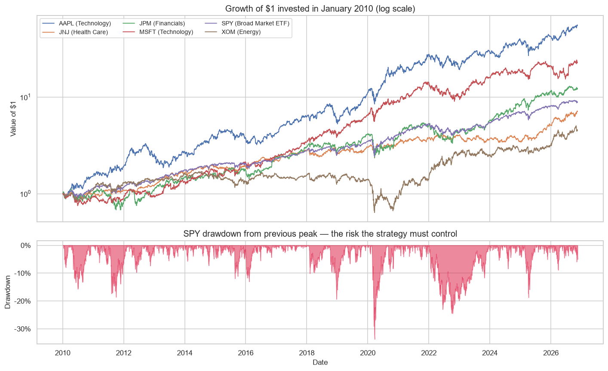
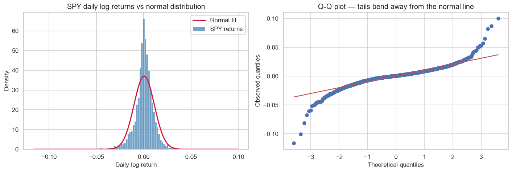
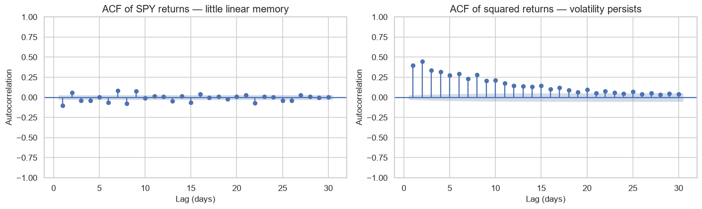
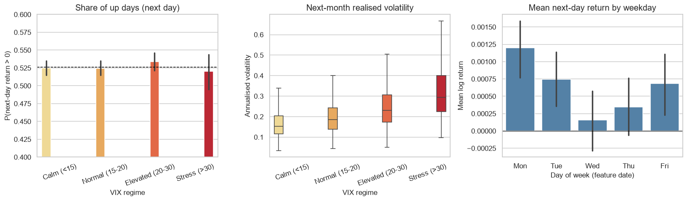
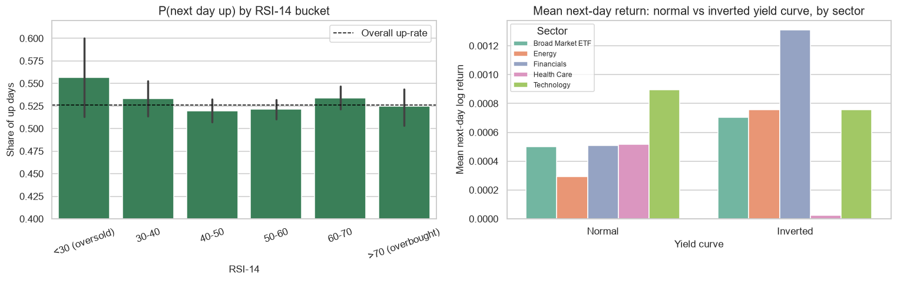
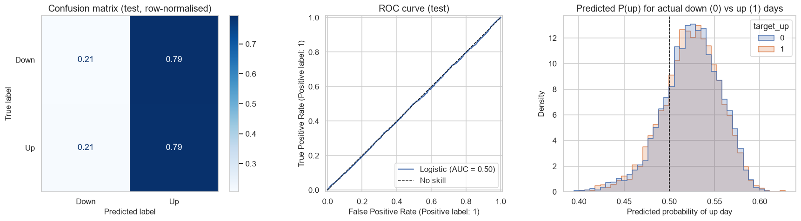

# Predicting Stock Price Direction from Market Micro-Movements and Macroeconomics

**Capstone Project — Berkeley ML/AI Professional Certificate**

**Initial Report and Exploratory Data Analysis**

📓 **Notebook:** [notebooks/capstone_eda_baseline.ipynb](notebooks/capstone_eda_baseline.ipynb)

---

## Research Question

Is it possible to predict stock price movements from daily price/volume behaviour (technical indicators such as EMA,
RSI and MACD) combined with macroeconomic conditions? And can those predictions drive an algorithmic trading
strategy that earns a strong risk-adjusted return while **avoiding severe drawdowns**?

For this initial report the question is framed as a **binary classification**: *will a stock's return tomorrow be
positive?* The project's success target is **directional accuracy above 55%** on unseen data.

## Data Sources

| Source | Data | Frequency |
|---|---|---|
| [Yahoo Finance](https://finance.yahoo.com) (`yfinance`) | Adjusted OHLCV for SPY, AAPL, MSFT, JPM, XOM, JNJ, 2010–2025 | Daily |
| [FRED](https://fred.stlouisfed.org) | 10Y & 2Y Treasury yields, 10Y–2Y spread, VIX | Daily |
| [FRED](https://fred.stlouisfed.org) | Fed funds rate, CPI, unemployment rate | Monthly |

The tickers cover the broad market plus four sectors (technology, financials, energy, health care), which gives a
categorical dimension to the analysis. Financial-news sentiment (FinBERT) is planned for final submission.

## Methodology

1. **Data cleaning** — type conversion, duplicate and invalid-bar removal, missing-value profiling.
   Daily macro gaps (bond holidays) are forward-filled. Monthly macro values are shifted to their publication date
   (~6 weeks after the reference month) before an as-of merge, to prevent look-ahead bias.
2. **Outlier analysis** — z-score and IQR analysis of returns and volume, and a check for data errors (e.g. >40% daily
   moves from unadjusted splits). Genuine extreme days (crashes) are kept because they are the drawdowns the strategy
   must survive. For the linear model, features are winsorised at training-set 1st/99th percentiles.
3. **Feature engineering** — log returns (1/5/21 day, lags), EMA-12/26 distance, MACD and histogram (scaled by
   price), RSI-14, 21-day realised volatility, Bollinger width/position, high-low range, volume z-score, macro levels
   and changes, VIX regime, yield-curve inversion flag, day of week. Target = sign of the next day's log return.
4. **Exploratory analysis** — growth and drawdown curves, return distributions (histogram + Q-Q), ADF stationarity
   tests, seasonal decomposition, ACF of returns and squared returns, volatility vs VIX, macro panel, rolling
   stock/yield correlation, Spearman correlation heatmap, and regime/categorical comparisons.
5. **Baseline model** — a naive "always up" classifier versus a **logistic regression** (scaled numeric features +
   one-hot ticker/weekday, C tuned with TimeSeriesSplit). Train on 2010–2021, test on 2022 onwards, with a 5-day
   embargo between them. Predictions are also turned into a long/flat strategy with 5 bps transaction costs.

### Evaluation Metrics and Rationale

| Metric | Why |
|---|---|
| **Directional accuracy** | The metric in the problem statement (target > 55%); the share of days the sign is called correctly. |
| **Balanced accuracy** | Up days are slightly more common than down days, so plain accuracy flatters an "always up" model. |
| **ROC-AUC** | Measures ranking skill independent of the 0.5 threshold; 0.5 = no skill. |
| **Sharpe ratio, max drawdown** | The research question is about risk-adjusted return and avoiding severe drawdowns, so predictions are also judged economically. |

## Summary of Findings

### Exploratory data analysis

- **Prices are non-stationary; returns are stationary.** ADF tests cannot reject a unit root for price levels but
  strongly reject it for log returns, so all modelling uses returns and scale-free indicators.
  
- **Returns are fat-tailed.** Excess kurtosis is far above zero and many more days exceed |z| > 3 than a normal
  distribution predicts. These extremes match VIX spikes (e.g. the March 2020 COVID crash). They are real events,
  not data errors.
  
- **Direction has little memory, but volatility has a lot.** Returns show near-zero autocorrelation, while squared
  returns are strongly autocorrelated (volatility clustering). Risk is more forecastable than direction, which
  points to volatility-based position sizing as a drawdown-control tool.
  
- **Market regimes change the relationships.** High-VIX regimes are followed by much higher realised volatility, and
  the correlation between stock returns and Treasury-yield changes switches sign over time (e.g. around 2022). A
  static model is unlikely to capture this, which supports the regime-aware Temporal Fusion Transformer planned next.
  
- **Individual features are only weakly correlated with next-day returns**, as expected in liquid markets. This is
  the central difficulty of the research question.
  

### Baseline model

| Model (test set, 2022+) | Directional accuracy | Balanced accuracy | ROC-AUC |
|---|---|---|---|
| Naive (always up) | 0.5304 | 0.500 | 0.500 |
| Logistic regression | 0.5156 | 0.4979 | 0.4964 |

| Strategy (test set, 2022+) | CAGR | Sharpe | Max drawdown |
|---|---|---|---|
| Buy & hold, equal weight | 18.2% | 1.15 | -16.5% |
| Logistic long/flat (5 bps costs) | 10.3% | 0.81 | -16.1% |



**Interpretation:** The logistic-regression baseline shows no predictive skill on the 2022+ test period. Directional accuracy (51.6%) is below the naive “always up” baseline (53.0%) and the 55% target, and balanced accuracy (0.498) and ROC-AUC (0.496) are at the no-skill value of 0.5. The long/flat strategy built on its signals roughly halved the annual return (10.3% vs 18.2%) and lowered the Sharpe ratio (0.81 vs 1.15) without reducing maximum drawdown (−16.1% vs −16.5%). Its in/out decisions were effectively random: it missed rallies as often as it avoided declines. This matches the EDA, which found near-zero autocorrelation in daily returns, weak feature–return correlations, and a regime change around 2022 that a linear model trained on 2010–2021 cannot adapt to. The EDA also found that volatility is strongly persistent, so final submission will shift focus from predicting daily direction to forecasting risk for position sizing and drawdown control, using longer horizons, non-linear and regime-aware models (gradient boosting, TFT), news sentiment, and walk-forward retraining.

## Automated Daily Data Pipeline

The src/ package keeps the dataset up to date automatically and feeds it to the model every trading day.

```
 Yahoo Finance ─┐
                ├─► 1. Ingest ─► 2. Validate ─► 3. Features ─► 4. Train (weekly) ─► 5. Predict ─► predictions
 FRED ──────────┘    (incremental)   (quality gate)  (shared with notebook)  (versioned)             + live scorecard
                              │                                                                   │
                              └──────────────────────── db/market.db (SQLite) ◄──────────────────┘
```

| Step | Module | What it does |
|---|---|---|
| 1. Ingest | src/ingest.py | Downloads only new data (plus a 10-day overlap). If Yahoo has re-adjusted a ticker's history after a dividend or split, that ticker is fully reloaded. FRED is re-pulled for the last ~13 months to capture revisions. All writes are upserts, so re-running is safe. |
| 2. Validate | src/validate.py | Stops the run before predicting if data is stale, tickers are out of sync, prices are invalid, or a >40% one-day move suggests a data error. |
| 3. Features | src/features.py | Rebuilds the feature table with the same definitions used in the notebook. Values are point-in-time: FRED daily series are lagged one business day and monthly series ~6 weeks, to match when they are actually published. |
| 4. Train | src/model.py | Retrains every 7 days (or with --force-retrain) on all labelled history. Each model is saved as models/model_YYYYMMDD.joblib, with models/latest.json recording its training window and CV score. |
| 5. Predict | src/pipeline.py | Writes P(up) for each ticker's next session to the predictions table, then scores past predictions against what actually happened (live directional accuracy). |

**Database tables (`db/market.db`):** `prices`, `macro`, `features`, `predictions`, `pipeline_runs` (one row per
run with status and error message, for monitoring).

### Running it

```bash
python tests/test_pipeline_offline.py   # offline end-to-end test with simulated data (no internet)
python scripts/check_sources.py         # confirm Yahoo Finance and FRED are reachable
python -m src.pipeline                  # first run backfills 2010-today; later runs fetch only new days
python -m src.pipeline --force-retrain  # retrain the model now
python scripts/status.py                # health report: runs, data freshness, model, latest predictions
```

Once `db/market.db` exists, the notebook loads its data from the database automatically.

### Scheduling

* **GitHub Actions (runs in the cloud)** — `.github/workflows/daily_pipeline.yml` runs at 23:30 UTC
  on weekdays, after the US close. Runners are wiped after each run, so the database and models are kept in
  **Azure Blob Storage**. One-time setup: create a storage account, copy its connection string, and add it as the
  repository secret `AZURE_STORAGE_CONNECTION_STRING` (Settings → Secrets and variables → Actions). GitHub
  send email if a run fails.

### Querying the data

```python
import sqlite3, pandas as pd
con = sqlite3.connect('db/market.db')
pd.read_sql("SELECT * FROM predictions ORDER BY date DESC LIMIT 6", con)
pd.read_sql("SELECT * FROM pipeline_runs ORDER BY run_id DESC LIMIT 5", con)
```

## Next Steps (Final Submission)

1. Add FinBERT sentiment scores from financial-news headlines.
2. Replace the single split with walk-forward (rolling-origin) evaluation.
3. Try non-linear models (gradient boosting) and the Temporal Fusion Transformer for multi-horizon quantile forecasts.
4. Add volatility-targeted position sizing, stop-losses and portfolio-level drawdown limits, then the RL execution agent.

## How to Run

```bash
pip install -r requirements.txt
jupyter notebook notebooks/capstone_eda_baseline.ipynb
```

The first run downloads the data (internet access required) and caches it in data/raw/. Later runs use the cache.
Delete the cached CSVs to refresh the data.
